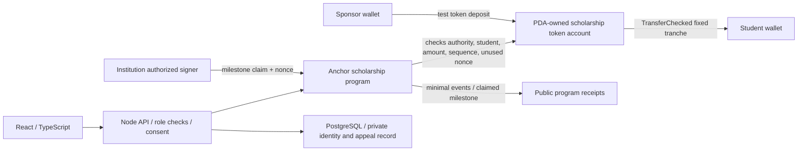

# Beca Modular 2.0 — trust and Web3 architecture

Updated 2026-10-10. This is a **proposed design**, not a deployed contract or legal trust/fideicomiso. The website remains static local simulation. No real assets, school credentials, or AI service are connected.

## Chosen core: fixed academic tranches to the student

The hackathon proof should demonstrate one complete, test-asset flow:

One network for MVP: Solana devnet. Proposed contract: Anchor program; vault token account controlled by a PDA; fixed supported SPL token mint; `TransferChecked`; scholarship config binds sponsor, institution signer(s), student token account, total commitment, tranche size, number/order of milestones, expiration, pause flag, and nonce/claimed state.

`release_tranche` must atomically check: the instruction is signed by a program-authorized institution wallet; scholarship is active; student/mint match stored configuration; requested milestone equals the next permitted milestone; nonce has not been consumed; amount is fixed by config; and vault balance covers the transfer. Persist replay state and transfer within one instruction so partial updates cannot authorize a second release.

For a hackathon, using a trusted institution keypair in devnet is a **synthetic attestor**, not a school-issued credential. State this in the demo. Production would need institution onboarding, signer revocation/rotation, multi-authority requirements, appeals, wallet recovery, legal, and independent program audits.

## Minimal on-chain / off-chain data

| On-chain config/state | Off-chain private service |
|---|---|
| Random program ID; sponsor pubkey; institution authority pubkey; student wallet; mint; total/fixed tranche; milestone count/index; expiry; paused/closed flags; claimed nonce/state | Student identity and contact; DNI if legally required; grades/transcripts; eligibility evidence; reason for pause; appeal notes; consent and policy text; sponsor agreements; support history |

Use no names, DNI, grades, medical/financial reasons, or free-text academic notes on-chain. A wallet address is pseudonymous, not anonymous, and can be correlated. Do not expose program/student linkage unnecessarily.

The institution signature authenticates which key signed the claim; it does not prove learning or make an appeal unnecessary. Hashing private details on-chain can still leak through correlation or later disclosure; avoid it unless a scoped use is established.

## Roles and boundaries

- Sponsor funds the config; cannot revise already signed student terms unilaterally.
- Institution wallet attests a defined academic outcome; no AI or backend may impersonate the authority.
- Student receives payment and can pause/request human review; no repayment of prior installments and no automatic forfeiture on inactivity.
- Program admin handles enrollment, consent, disputes, key rotation, and future-only reassignment under policy.
- Platform signer, if one exists, must be separate from student-facing web code and never embedded in browser assets. Define a multisig or secure signer policy before real funds.

## Pause, appeal, close, and reassignment

`pause_program` blocks new releases; it does not reclaim paid money. Do not implement automatic “dropout” inference. Any closure/reassignment needs authorized human status, notice, grace interval, appeal path, and decision record. Reassign only future funds that are neither earned nor promised under accepted terms. The remainder does not automatically move to the next student: the program/sponsor makes a distinct authorized allocation.

Devnet MVP should stop after one successful release + tampered and duplicate rejections. If demonstrating pause/reassignment, use a separately controlled test program and only after clear states/tests; it is not core acceptance criteria.

## Yield / treasury boundary

MVP: **zero yield allocation**. Never deposit promised scholarship principal in a lending vault. A future version may create a separate treasury for explicitly authorized uncommitted surplus, with distinct accounting, exit reserve, risk caps, pause and sponsor top-up policy. On same chain, a Solana adapter such as Kamino KLend could be investigated; it is a distinct protocol position and does not compose automatically with MPP channels. Aave/Morpho/Spark routes are EVM and would require a separate chain architecture or a carefully audited bridge (out of scope).

For scheduled payouts, do not use displayed APY to authorize a due payment. Check product-specific withdrawable amount, same-token amount actually received, fees, slippage, delay, and contract status before any payout. If redemption cannot complete, funds cannot be reported as liquid. Only positive, realized net surplus can be allocated under a policy chosen before enrollment. If that policy permits a student benefit, the sponsor may pre-authorize eligible options and let the student choose among them; the student cannot be forced to reinvest the original promised amount. The website's option selector is a local concept simulation, not a transfer flow. See [yield-strategy.md](yield-strategy.md).

## Separate optional content-payment module (MPP)

Solana MPP remains a separate provider-content flow and budget. It holds a session ceiling and supports cumulative signed vouchers for measured usage; it does not verify academic milestones. The prior sandbox experiment documents one happy-path content session, but neither that test nor the website proves the scholarship contract above. Never send scholarship funds through a provider session or claim that the MPP voucher is a school credential.

## AI boundary

Optional module guidance only: input = consented goal/time/declared level plus approved catalog. Output = schema-validated approved resource IDs, prerequisites, short rationale. Student selects; deterministic budget and authority rules run afterward. No eligibility, grade, dropout, payout, yield choice, secret access, or transaction signing. Use a fixed evaluation set and compare with deterministic filters; remove the model if it does not improve educator relevance and choice effort. AI is currently not connected.

## Contract acceptance tests before a demo

1. Sponsor deposits test tokens; stored balance equals actual vault balance.
2. Authorized institution signer releases exactly one configured tranche to the configured student.
3. Unauthorized signer, wrong mint, wrong student, wrong amount, expired program, out-of-order milestone, invalid signature, and reused nonce fail without state or token change.
4. Transaction replay cannot pay twice.
5. Pause blocks new release; resume requires authorized instruction and leaves past paid balances unchanged.
6. Vault underfunding fails explicitly; no UI shows “paid” until the devnet transfer confirms.
7. Uncommitted close/reassignment (if implemented) cannot move prior paid or promised installments.
8. Build and test repeatable on a fresh local validator/devnet setup; no secret in frontend/repository.

Do not test with real funds. Do not present Anchor primitives, an MPP sandbox test, or this website as an audited smart contract.

## 48-hour implementation choice

Use TypeScript/React (or this site's vanilla TypeScript-compatible modules for a prototype), Node/Express only if a private signer/backend is needed, Anchor + SPL Token, devnet, and SQLite/PostgreSQL for private program state. Minimize dependencies and pin versions. Split work: contract/state tests; student/sponsor UI; attestor flow; integration/QA/pitch. Freeze an end-to-end devnet slice by hour 30–32. Yield, content MPP, AI integration, multi-chain, and automatic reassignment are excluded.

The hardest dependency is a correct, replay-safe PDA vault transfer contract. First two-hour spike: create local/deployable program skeleton and demonstrate test-token deposit + one authorized transfer + duplicate rejection. Pass only if all four are reproducible and no commitment is sent without the attestor signer. If it fails, show the local scholarship simulation honestly, and do not claim on-chain escrow works.
