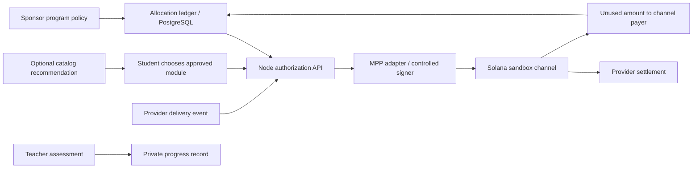

> Corrección de alcance — 10/10/2026: revisada la transcripción completa del audio original. La propuesta principal paga tramos al ESTUDIANTE por materias aprobadas por una institución. La web ahora lo explica primero y ofrece una simulación local. El contenido siguiente documenta el COMPLEMENTO de pago por contenido al PROVEEDOR, no un escrow académico implementado. MPP no certifica materias ni reasigna becas. Presupuestos separados; IA no autoriza pagos. No hay contrato de becas desplegado ni demanda validada.

# Web3, AI and trust architecture

Date: 2026-10-10. **Proposed integration**, not current website functionality. Current website is a deterministic standalone JS simulation. Prior sandbox successful flow is in `../../spike-execution-log.md` and has not been rerun here.

## One coherent MVP

Use the existing MPP session channel as the only onchain escrow. Sponsor-controlled application maintains an **offchain allocation ledger**. One student allocation can fund multiple providers over time, but every active MPP session has one configured provider. Reserve allocation atomically before opening each channel; do not allow multiple sessions to independently spend the same budget.

Sponsor approves channel cap; an explicitly designated bounded signer issues usage vouchers only after policy validates delivery and resource price. The precise payer/authorized-signer delegation must be proven against the actual SDK before integration is called viable. A sponsor test wallet can be used with explicit approval in the hackathon. Student wallet abstraction/custody is **not implemented**; no claim that production is “walletless” by magic.

Never expose private signer material in browser. A web caller cannot supply price, payee or arbitrary module IDs to the signing endpoint. Deduplicate events in a transaction before updating accepted amount. A crash between authorizing delivery and saving a voucher needs a recoverable durable log and idempotent retry.

## Mechanism decisions

| Mechanism | Trust/guarantee | Simpler alternative | Decision |
|---|---|---|---|
| Stablecoin educational reserve | Payer custody, token issuer risk, RPC and signer availability | Bank-account reserve | Test assets only; production gated |
| Channel escrow | Protocol can reserve and settle under its rules; not legal fiduciary trust | Processor authorization + ledger | MPP MVP; no second vault |
| Capped authorization | Must bind channel, signer, mint, recipient, cumulative amount | Credit limit in API billing | MVP; adversarial over-cap test required |
| Cumulative vouchers | Signed increasing totals, not independent additive transfers | Metered invoices | MVP; signature/counter/replay persistence required |
| Settlement receipt | Shows token transfer on correct cluster; does not prove delivery quality | Reconciled signed invoices | MVP sandbox with full cluster labeling |
| Unused balance | Close returns to payer, subject to protocol settlement/recovery rules | Cancel authorization | MVP happy path; failure recovery spike |
| Academic milestone attestation | Institution's signature proves origin, not factual grade truth | LMS record + signed report | Separate progress ledger; no payment oracle MVP |
| Reassignment | Program discretion bounded by rights and outstanding commitments | Manual budget reassignment | Human-approved offchain policy roadmap |
| Shared treasury governance | Multi-signatures reduce unilateral control, increase operations | Two-person approvals | Roadmap only if sponsor needs it |
| Creator fees | Variable trading-fee contribution, not productive guaranteed income | Donation from creator treasury | Optional later deposit; no funding dependency |
| Privacy credentials / ZK | Issuer still trusted; key recovery and revocation needed | Minimize data + access controls | Not MVP absent privacy requirement |

MPP docs inspected: https://solana.com/docs/payments/agentic-payments/mpp . Local MIT Pay Kit checkout reports package `@solana/pay-kit` **0.13.1**; existing playground uses React 19 and TypeScript ^5.7. Integration versions must be locked and retested at build. No proprietary protocol reimplementation. Preserve upstream MIT notices when reusing source. New website contains original code; uses no bundled third-party libraries/assets.

## Proposed data model

- Program(id, sponsor_id, currency, approved_catalog, policy_version, status).
- Enrollment(id, program_id, pseudonymous_student_id, consent_version, status).
- Allocation(id, enrollment_id, allocated_minor, reserved_minor, settled_minor, released_minor, version). Database transaction enforces nonnegative available funds.
- Module(id, provider_id, unit_definition, price_minor, prerequisites, content_version, approved_by).
- Session(id, allocation_id, provider_id, cap_minor, channel_id, network, status, signer_reference).
- UsageEvent(id, session_id, resource_id, delivery_nonce, cumulative_minor). Unique(session_id, delivery_nonce); enforce monotonic total; price from approved catalog.
- Settlement(id, session_id, network, signature, settled_minor, returned_minor, status). Unique(session_id, settlement_watermark).
- Progress(record_id, module_id, assessment_issuer, assessment_version, appeal_status). Separate private record; not consumed by payment authorization MVP.
- Review(id, enrollment_id, type, reason_private, decision_by, notice_at). Access limited; no sensitive reason in public records.

States: proposed → reserved → open → paused/resumed → closing → settled/returned; failure and dispute states must remain explicit. “Paused” is application policy that prevents new vouchers; it does not cancel existing authorized liabilities or invent a channel instruction. Never mark settled on a frontend click; reconcile RPC confirmed state and transfer amounts.

## AI architecture (optional, not connected)

Input: learning goal, declared level/time, consent and a human-approved catalog subset. No DNI, grades, financial hardship narrative or private notes. Output: structured module IDs, reason, prerequisites and estimate; validate JSON schema, membership and budget deterministically. If validation fails, return tagged catalog choices. Student confirms; advisor can override. Prompt-injected catalog descriptions must never become instructions to financial tools.

LLM has no signing key, transfer tool, eligibility role or academic certification role. Do not let its output change catalog prices, providers or fund rules.

Evaluation: fixed anonymized task set; compare tag filters and LLM for selection time, educator-rated relevance, invalid IDs, missed prerequisites and user understanding. Gate: zero out-of-catalog actionable outputs and no funds authority; better relevance/time in a directional human trial; latency target <3 s with fallback (target, not measured). No fine tuning needed. Model/provider remains undecided pending current price/privacy comparison. Simulator AI budget 0.25 USD/student/month is an assumption; measure requests × input/output tokens × actual price before quoting operating cost. Website's route selector is explicitly rule-based.

## Production blockers and security gates

1. Sponsor authorization and student/provider/session binding; cap across concurrently open channels.
2. Replay, tampering, wrong mint/recipient/network and nonmonotonic voucher rejection.
3. Durable state and unilateral unused-funds recovery on server failure; protocol time windows specified.
4. Exact definition of deliverable versus payment, disputes and provider quality. The blockchain is not an oracle of learning.
5. Custody, onboarding, on/off ramp, token risk, privacy and legal agreements before real funds.
6. Revocation/correction of academic records without pretending that settled transfers can be revoked.
7. Academic pause, withdrawal, consent, grace and appeal policies protect students; no automatic confiscation or reassignment based on silence.

No mainnet write, financial contract deployment, new signature proof or LLM request is made by this website.
