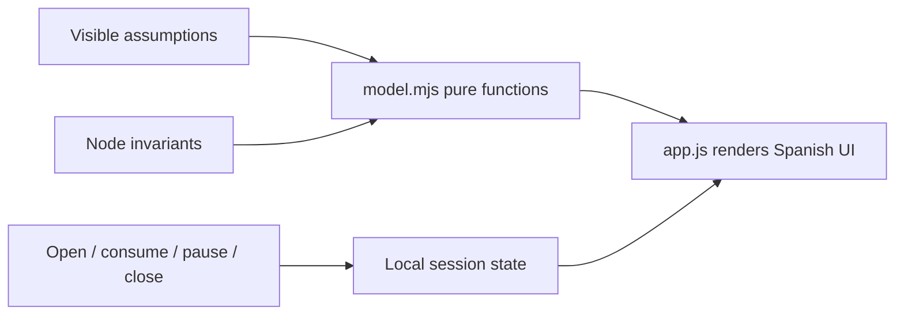

# Beca Modular — how the product lab works

Project learning guide, 2026-10-10. Source copy in the product repository; vault copy is recorded in the QA receipt when saved. Project-folder AGENTS.md was absent; vault-root AGENTS.md and style/workflow rules were then read successfully.

The product connects a funding institution, a learner and an education provider. This website explains the proposal with local calculations. It does not move money or ask an AI model to decide what a person deserves.

## Four concepts worth understanding

1. **A state machine** limits valid actions. You can consume only in an open, unpaused session. Closing records the used total and returns the rest in the example. See `model.mjs: transition`.
2. **An accounting identity** must always balance. Allocation equals payouts plus unused funds. Platform revenue is separate from educational principal. See `model.mjs: financial` and the financial document.
3. **Idempotency** means repeating a request does not charge again. The example tracks unit IDs; a real service needs atomic durable storage. Reloading this page resets state, so it is not a production ledger.
4. **A trust boundary** says who is allowed to decide. A provider reports delivery, a teacher assesses learning, the sponsor authorizes budget. A payment channel verifies payment rules, not learning quality.

`index.html` contains the content and semantic sections; `styles.css` defines responsive composition; `app.js` connects real controls to model output; `server.mjs` serves the local files. Run commands and verification evidence are in README/QA. No build step or dependencies are needed.

Try changing utilization from 65% to 80% while leaving the platform fee at zero. Provider payouts increase, while license revenue stays fixed. Explain why the result becomes worse for the platform and why that must not become an incentive to deny access. Then raise support costs and check which assumption matters more.

The next engineering step is an actual sponsor-controlled MPP integration spike. The next product step is one real program workflow and an accepted content billing unit. No course connections are asserted without inspecting the relevant notes.

## Verified course connections

- [[Efforts/Universidad/2026/Q2/Ingeniería de Datos I/Clases/Clase 1 - 05-08-2026|Data Engineering I — Class 1]] explains ACID and keys. In the proposed backend, reserving an allocation and recording a delivery must happen atomically; otherwise concurrent sessions can overspend. The local UI does not provide a database transaction.
- [[Efforts/Universidad/2026/Q2/Ingeniería de Datos I/Clases/Clase 8 - 23-09-2026|Data Engineering I — Class 8]] discusses declarative consistency constraints. Unique(session_id, delivery_nonce) and nonnegative-balance checks are concrete applications to the proposed usage ledger. The connection is our engineering explanation, not a course claim that this product was discussed.

Both note bodies were inspected for these passages on 2026-10-10. No academic material was modified or promoted.
