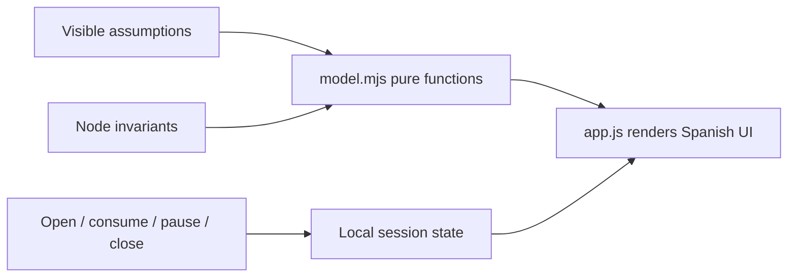
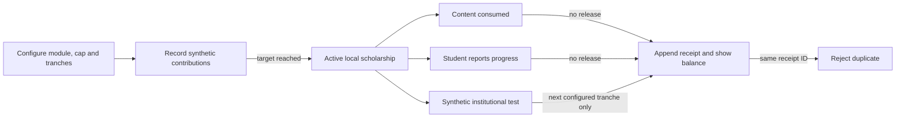

# Beca Modular — how the product lab works

Project learning guide, 2026-10-10. Source copy in the product repository; vault copy is recorded in the QA receipt when saved. Project-folder AGENTS.md was absent; vault-root AGENTS.md and style/workflow rules were then read successfully.

The product connects a funding institution, a learner and an education provider. This website explains the proposal with local calculations. It does not move money or ask an AI model to decide what a person deserves.

## Four concepts worth understanding

1. **A state machine** limits valid actions. You can consume only in an open, unpaused session. Closing records the used total and returns the rest in the example. See `model.mjs: transition`.
2. **An accounting identity** must always balance. Allocation equals payouts plus unused funds. Platform revenue is separate from educational principal. See `model.mjs: financial` and the financial document.
3. **Idempotency** means repeating a request does not charge again. The example tracks unit IDs; a real service needs atomic durable storage. Reloading this page resets state, so it is not a production ledger.
4. **A trust boundary** says who is allowed to decide. A provider reports delivery, a teacher assesses learning, the sponsor authorizes budget. A payment channel verifies payment rules, not learning quality.

`index.html` contains the content and semantic sections; `styles.css` defines responsive composition; `app.js` connects real controls to model output; `server.mjs` serves the local files. Run commands and verification evidence are in README/QA. No build step or dependencies are needed.

Try changing utilization from 65% to 80% while leaving the platform fee at zero. Provider payouts increase, while license revenue stays fixed. Explain why the result becomes worse for the platform and why that must not become an incentive to deny access. Then raise support costs and check which assumption matters more.

The next engineering step is an actual sponsor-controlled MPP integration spike. The next product step is one real program workflow and an accepted content billing unit. No course connections are asserted without inspecting the relevant notes.

## Verified course connections

- [[Efforts/Universidad/2026/Q2/Ingeniería de Datos I/Clases/Clase 1 - 05-08-2026|Data Engineering I — Class 1]] explains ACID and keys. In the proposed backend, reserving an allocation and recording a delivery must happen atomically; otherwise concurrent sessions can overspend. The local UI does not provide a database transaction.
- [[Efforts/Universidad/2026/Q2/Ingeniería de Datos I/Clases/Clase 8 - 23-09-2026|Data Engineering I — Class 8]] discusses declarative consistency constraints. Unique(session_id, delivery_nonce) and nonnegative-balance checks are concrete applications to the proposed usage ledger. The connection is our engineering explanation, not a course claim that this product was discussed.

Both note bodies were inspected for these passages on 2026-10-10. No academic material was modified or promoted.

## Current demo snapshot — 2026-10-15

This section describes the newer funding demo and supersedes the earlier “next engineering step” above for the current hackathon walkthrough. The source still has no persistent service or payment integration.

### How to inspect the invariant

- `funding-model.mjs` owns the local state transitions. `initialFundingDemo` requires all positive tranche amounts to sum exactly to the cap. `contribute` cannot exceed the remaining amount. `recordProgress` releases only the next `institution-test` tranche and records a unique receipt ID. Content use and student-reported progress record zero payout.
- `roadmap.mjs` connects those pure functions to the page and renders total, released, reserved, status and receipt details. `demo.html` carries the product copy and labels each synthetic step.
- `tests/funding.test.mjs` checks cap, replay, exact balance, invalid states and cent rounding. `tests/demo-browser.cjs` checks the configured flow in a browser at desktop, tablet and mobile widths.
- This local pattern is not yet a distributed transaction. In a future service, contribution and release state would need durable atomic updates plus an idempotency constraint. The database consistency connection is grounded in the previously inspected [Data Engineering I — Class 1](<D:/Facultad/UADE-Vault/Efforts/Universidad/2026/Q2/Ingeniería de Datos I/Clases/Clase 1 - 05-08-2026.md>) and [Class 8](<D:/Facultad/UADE-Vault/Efforts/Universidad/2026/Q2/Ingeniería de Datos I/Clases/Clase 8 - 23-09-2026.md>) notes; it is our application of ACID/constraints, not a claim that the course covered this product.

The vault project guide was not edited from this repository session; this Markdown is the repo-side guide copy to transfer when the vault is writable.

## UX and scroll-story milestone — 2026-10-15

The landing page now demonstrates a useful form of scroll storytelling: the reader keeps using ordinary vertical scrolling, while a pinned desktop viewport moves through four horizontal chapters. The visual movement is a presentation layer over normal semantic articles; it does not decide program eligibility or release money. On small screens or with reduced motion, the same articles stack in reading order.

roadmap.mjs measures the section’s scroll progress and translates .story-track; styles.css pins the stage only above 900 px and for prefers-reduced-motion: no-preference. The HTML is the source of all story text and fallback content. Four articles cover question, evidence, program and receipt. Keyboard users can use the visible chapter links or left/right arrows while focus is inside the stage.

docs/ux-redesign.md records the visual decisions and inspected sources. It distinguishes the canonical student-tranche product model from provider-payment experiments. The only quantitative example is an explicitly fictional 100 USD budget split into two 50 USD tranches. The official dropout indicator is a candidate source, not an applied metric. OpenArg stays an external map catalog, and DatosHoy is an external university map; the live browser and text fetch disagreed about 2024 data availability, so Beca Modular does not copy its figures.

index.html connects the first-screen CTA to demo.html. The local simulation remains the only working funding flow; it uses synthetic participants and receipts, not an institution or payment network.

node server.mjs serves the source at http://127.0.0.1:4178/; there is no landing-page build step or new dependency. The static dist/ files mirror the source. See docs/qa.md for the actual responsive, scroll, reduced-motion, fallback and demo checks after they run.

For the chapter sequence, prefer native vertical scroll as the control and let it drive a pinned visual track only on desktop. Keep the four article panels in normal document order so small screens, reduced-motion preferences, and JavaScript failure retain the entire story. Brote is a decorative guide, not a proxy for a real student or evidence of an outcome.
